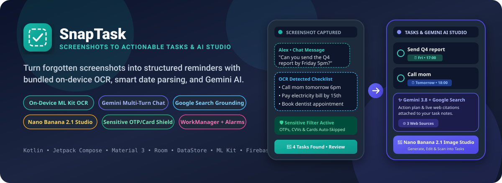
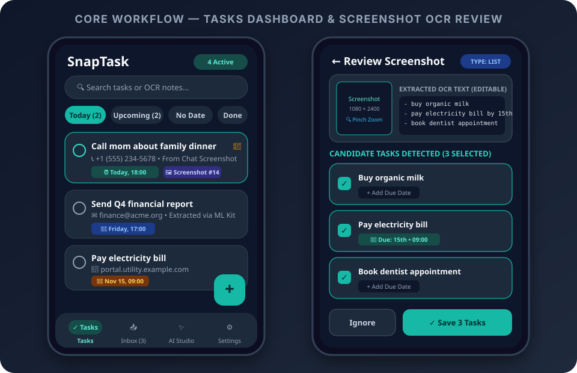
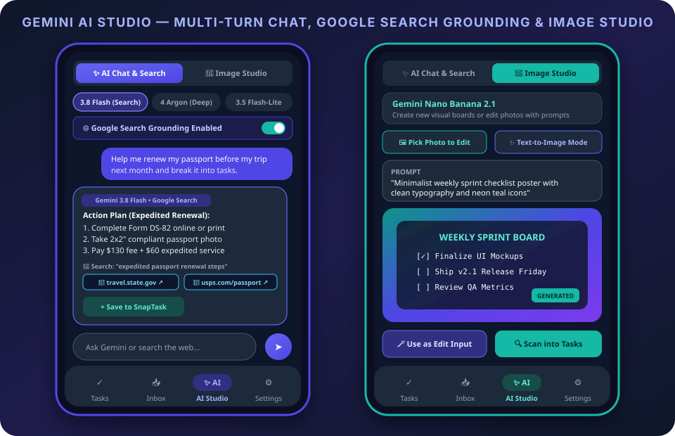
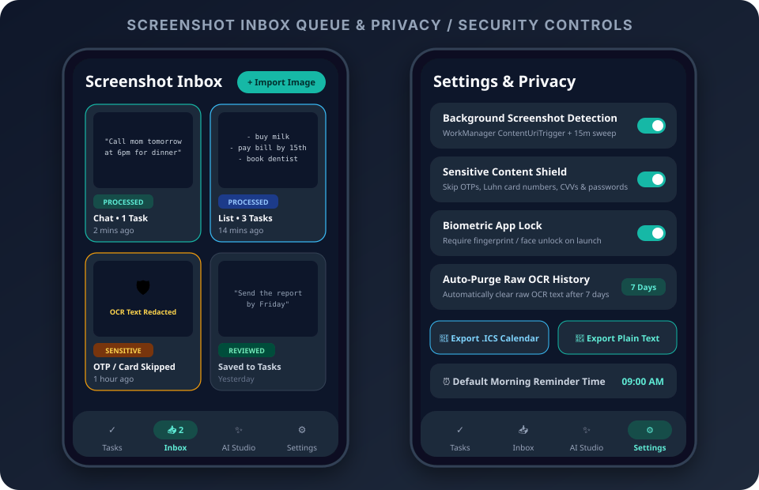

<div align="center">



# SnapTask 📸✅✨

**Turn Forgotten Screenshots into Actionable To-Do Tasks, Smart Reminders & AI-Grounded Plans**

[-14B8A6?style=for-the-badge&logo=android&logoColor=white)](#)
[](#)
[](#)
[](#)
[](#)

</div>

---

## 🌟 Overview

People constantly screenshot chat messages, shopping lists, receipts, and ideas—only for those screenshots to get buried in the camera roll. **SnapTask** closes that loop automatically:

1. **Background Screenshot Detection**: Detects new screenshots via `WorkManager` (`ContentUriTrigger` + periodic sweep) without requiring a battery-draining foreground service.
2. **Bundled On-Device OCR**: Extracts text offline from the very first launch using Google ML Kit's bundled text recognition model (`com.google.mlkit:text-recognition`), automatically tiling tall scrolling screenshots.
3. **Rule-Based Task & Date Parser**: Classifies screenshots (`CHAT`, `LIST`, `EVENT`, `OTHER`), extracts action items, parses natural-language dates/times (`"tomorrow 6pm"`, `"by 15th"`, `"next Monday"`, `"in 2 hours"`), and attaches phone numbers, emails, and URLs as tappable links.
4. **Sensitive Content Shield**: Automatically detects OTPs, verification codes, Luhn-validated credit/debit card numbers, CVVs, and passwords—skipping and redacting them so sensitive screenshots are never stored as tasks.
5. **Gemini AI Studio (Firebase AI Logic)**:
   - **Multi-Turn AI Chatbot**: Switch between **Gemini 3.8 Flash**, **Gemini 4 Argon**, and **Gemini 3.5 Flash-Lite** to break down goals into tasks or plan your schedule.
   - **Google Search Grounding**: Ground responses in live web data using `Tool.googleSearch()` with clickable source citation chips.
   - **Nano Banana 2.1 Image Studio**: Generate new visual task cards or edit existing photos with text prompts (`gemini-nano-banana-2.1`) and scan them directly into tasks.

---

## 📱 App Screenshots & Visual Tour

### 1. Tasks Dashboard & Screenshot OCR Review Queue
Filter tasks by **Today**, **Upcoming**, **No Date**, and **Done**, pin high-priority items, or inspect any captured screenshot with pinch-to-zoom, editable OCR text, and candidate task checkboxes.

<p align="center">
  
</p>

### 2. Gemini AI Studio — Multi-Turn Chat, Google Search Grounding & Image Studio
Research any task with live Google Search citations, switch Gemini reasoning tiers on the fly, or generate/edit visual assets using **Gemini Nano Banana 2.1**.

<p align="center">
  
</p>

### 3. Screenshot Inbox Queue & Privacy Controls
Review auto-detected screenshots, see redacted `SENSITIVE` items caught by the Luhn/OTP filter, lock the app with **Biometric Prompt**, or export tasks to `.ics` (iCalendar) and plain text.

<p align="center">
  
</p>

---

## ✨ Key Features

| Feature Area | Capabilities |
| :--- | :--- |
| **Automatic Screenshot Detection** | • Primary `OneTimeWorkRequest` observing `MediaStore.Images.Media.EXTERNAL_CONTENT_URI` (including descendants) that re-enqueues itself after each trigger.<br>• Fallback `PeriodicWorkRequest` (every 15 minutes) + `BOOT_COMPLETED` receiver.<br>• Deduplication by MediaStore ID and sequential queue processing. |
| **Manual Import Paths (Always Active)** | • **In-App Photo Picker**: Zero-permission Android Photo Picker (`PickVisualMedia`).<br>• **System Share Target**: Share any `image/*` from Google Photos or any app directly to **SnapTask**.<br>• **Quick Settings Tile**: Launch screenshot import directly from the Android notification shade (`SnapTaskTileService`). |
| **Smart Task & Date Parser (`TaskParser`)** | • Merges wrapped lines and splits bulleted/numbered checklists (`-`, `•`, `[ ]`, `1.`).<br>• Detects action verbs (`call`, `email`, `buy`, `pay`, `book`, `submit`, `send`, `renew`, `remind`, `pick up`, `follow up`).<br>• Parses dates & times (`tomorrow 6pm`, `Fri 3 PM`, `next Monday`, `12/11`, `11 Nov`, `by 15th`, `in 2 hours`, `by EOD`).<br>• Extracts phone numbers, emails, and URLs as clickable chips. |
| **Sensitive Content Filter (`SensitiveContentFilter`)** | • Detects 4–8 digit OTP/verification codes in authentication contexts.<br>• Validates 13–19 digit payment cards via the **Luhn algorithm**.<br>• Flags CVV/CVC patterns and `password`/`passcode` credentials, marking records `SENSITIVE` without saving OCR text. |
| **Gemini AI Studio (`AiStudioScreen`)** | • **Multi-Turn Chat**: Streaming conversation with productivity system instructions and one-tap **Save to SnapTask**.<br>• **Model Selector**: Choose `gemini-3.8-flash` (General), `gemini-4-argon` (Complex Reasoning), or `gemini-3.5-flash-lite` (Fast Triage).<br>• **Google Search Grounding**: Live web search queries and clickable `WebGroundingChunk` citations.<br>• **Image Studio**: Create & edit images via `gemini-nano-banana-2.1` (`ResponseModality.IMAGE`) and run OCR on generated visuals. |
| **Privacy, Security & Exports** | • Zero image duplication: stores only MediaStore `content://` URIs and handles deleted screenshots gracefully.<br>• Optional **Biometric App Lock** (`BiometricPrompt`).<br>• Configurable auto-deletion of raw OCR text (`7`, `30`, or `90` days) and `.ics` / Plain-Text export. |

---

## 🏗️ Architecture & Tech Stack

- **UI Layer**: 100% Kotlin & Jetpack Compose with Material Design 3 (`DynamicColor`, Dark/Light themes, adaptive layouts, and `testTag` semantics).
- **State Management**: Single-Activity (`FragmentActivity`) + MVVM (`MainViewModel` and `AiAssistantViewModel`) using Kotlin Coroutines and `StateFlow`.
- **Persistence**:
  - **Room Database (`AppDatabase`)**: Stores `Task` and `ScreenshotRecord` entities with full-text search and status tracking (`NEW`, `PROCESSED`, `REVIEWED`, `IGNORED`, `FAILED`, `SENSITIVE`).
  - **Jetpack DataStore (`AppPreferences`)**: Persists user preferences, onboarding state, biometric lock settings, and last-processed MediaStore timestamps.
- **On-Device ML**: Bundled ML Kit Text Recognition (`com.google.mlkit:text-recognition:16.0.1`) with bitmap downscaling and tall-screenshot vertical tiling (`OcrProcessor`).
- **Cloud AI & Security**: Firebase AI Logic (`com.google.firebase:firebase-ai`) protected by Firebase App Check (`DebugAppCheckProviderFactory` for debug / `ReCaptchaEnterpriseProviderFactory` for release).
- **Background & Alarms**: AndroidX `WorkManager` (`ScreenshotTriggerWorker`, `ScreenshotSweepWorker`, `OcrCleanupWorker`) and `AlarmManager` (`ReminderScheduler`, `ReminderReceiver`).

### Project Structure

```text
app/src/main/java/com/example/
├── MainActivity.kt                  # Single-Activity host, App Check init, share intent & navigation
├── SnapTaskApplication.kt           # WorkManager configuration & notification channel initialization
├── ai/
│   └── AppCheckHelper.kt            # Firebase App Check debug/release provider setup
├── data/
│   ├── db/                          # Room Database (AppDatabase, TaskDao, ScreenshotDao, Converters)
│   ├── model/                       # Task, ScreenshotRecord, ScreenshotStatus, CandidateTask
│   ├── preferences/                 # Jetpack DataStore (AppPreferences)
│   └── repository/                  # SnapTaskRepository (OCR pipeline, Room & alarm coordination)
├── domain/
│   ├── OcrProcessor.kt              # Bundled ML Kit OCR with tall-screenshot tiling
│   ├── SensitiveContentFilter.kt    # OTP, password, CVV & Luhn card number shield
│   └── TaskParser.kt                # Offline heuristic task, date/time & contact extractor
├── notifications/                   # NotificationHelper, NotificationActionReceiver, ReminderScheduler
├── tile/                            # SnapTaskTileService (Quick Settings Tile)
├── ui/
│   ├── screens/                     # Onboarding, Tasks, Inbox, Review, TaskDetail, AiStudio, Settings
│   ├── theme/                       # Material 3 Color, Theme & Typography
│   └── viewmodel/                   # MainViewModel & AiAssistantViewModel
└── worker/                          # ScreenshotTriggerWorker, ScreenshotSweepWorker, BootReceiver
```

---

## 🔐 Permissions Breakdown

| Permission | Purpose |
| :--- | :--- |
| `READ_MEDIA_IMAGES` (Android 13+) | Detect newly captured screenshots in `MediaStore.Images`. |
| `READ_MEDIA_VISUAL_USER_SELECTED` (Android 14+) | Support Android 14+ partial photo access cleanly alongside manual Photo Picker imports. |
| `READ_EXTERNAL_STORAGE` (Android ≤ 12) | Read screenshot files on Android 8.0–12L devices. |
| `POST_NOTIFICATIONS` (Android 13+) | Post *"N tasks found in your screenshot"* alerts and scheduled task reminders. |
| `SCHEDULE_EXACT_ALARM` / `USE_EXACT_ALARM` | Fire exact due-time reminders and 15-minute / 1-hour / tomorrow snooze alarms. |
| `RECEIVE_BOOT_COMPLETED` | Re-schedule pending task reminders and re-arm the screenshot `ContentUriTrigger` after reboot. |
| `INTERNET` & `ACCESS_NETWORK_STATE` | Used by the **AI Studio** tab for Firebase AI Logic (Gemini Chat, Google Search Grounding & Image Studio). |

---

## 🧪 Running & Testing the App

### 1. Automatic Screenshot Detection
1. Launch **SnapTask** and complete the 3-step onboarding flow.
2. Capture a screenshot on your device or emulator containing a checklist or chat message (e.g., *"Can you send the report by Friday?"*).
3. Tap **Review** or **Save all** on the *"Tasks found in your screenshot"* notification, or open the **Inbox** tab inside the app.

### 2. Manual Import & Share Target
- **Import Button**: Tap **Import Screenshot** on the **Inbox** screen to select any image via the Android Photo Picker.
- **System Share**: Share any image from Google Photos or Files and choose **SnapTask** to jump straight into the OCR Review screen.

### 3. Unit & Robolectric Tests
Run the full test suite covering `TaskParser` date/time extraction, `SensitiveContentFilter` Luhn validation, and `MainActivity` startup verification:

```bash
gradle :app:testDebugUnitTest
```

Verified test scenarios include:
- `"Call mom tomorrow 6pm"` → **1 task**, due tomorrow at `18:00`
- `"- buy milk\n- pay electricity bill by 15th\n- book dentist"` → **3 tasks**, with the second task scheduled for the `15th`
- `"Can you send the report by Friday?"` → **1 task**, due upcoming `Friday`
- OTP codes, passwords, and Luhn credit card numbers → Flagged as `SENSITIVE` and skipped
